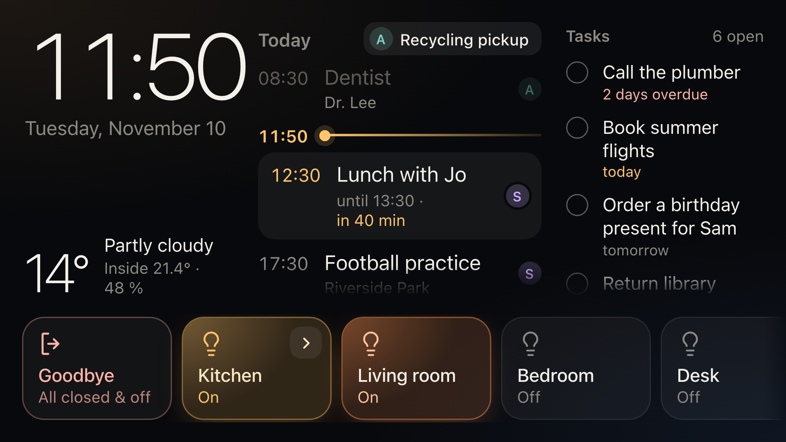
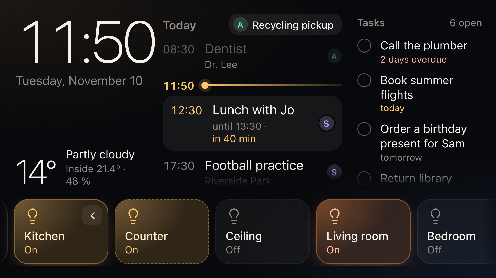
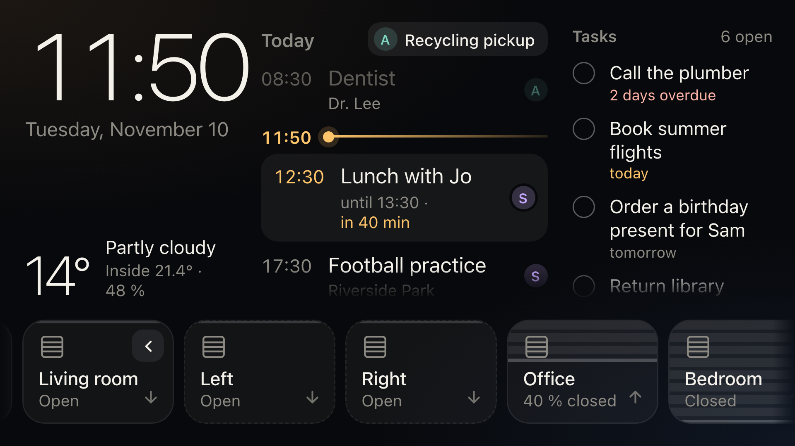

# saturn-panel

A Home Assistant wall panel for an old Android phone in landscape. It shows the clock, the weather, one agenda merged from several calendars and your to-do lists. A strip of light and shutter tiles runs along the bottom.



Mine runs on a Sony Xperia XZ from 2016, taped to the door intercom next to the front door. [An old phone as a wall display](docs/old-phone.md) has the photos, a video and the cabling.

The panel is plain HTML, CSS and JavaScript with no build step. Home Assistant serves the files, and a small Android app in `android/` shows them full screen.

## Try it without Home Assistant

Demo mode replaces Home Assistant with a fake one that has made-up calendars, tasks, lights and shutters. Taps work, and nothing leaves the page.

```sh
python3 -m http.server 8000
```

Open <http://localhost:8000/index.html?demo>. Add `&locale=de-DE` to see the German text. The demo data itself stays English.

## What it shows

- Clock, date, weather and the indoor temperature and humidity on the left.
- The next seven days from all your calendars in one list. A coloured initial marks whose event it is.
- A line that marks the current time between today's events. It stays in the middle of the agenda, with what is over above it and what comes next below it. After you scroll, the agenda waits 45 seconds and then glides back.
- Your to-do lists in a column of their own. The column shows only while a task is open or was ticked off in the last six hours. Tap a task to tick it off or back on.
- A swipeable strip with a welcome or goodbye tile first, then your lights, then your shutters. The arrow on a group tile slides its members out next to it. A colour light's tile glows in the colour the light shows.

Every five minutes the panel asks Home Assistant to update the calendars and to-do lists. On its own, Home Assistant's Google integration fetches only every 15 to 30 minutes.

 

## Set it up

### Create a user for the panel

In Home Assistant, add a person under **Settings > People**, allow it to log in, and leave **Administrator** off. Limit it to the local network if the phone never leaves your home.

The panel only reads states and calls services, so it does not need an admin. Home Assistant has no per-device permissions, though. This user can still switch every light and move every shutter. Being a non-admin keeps it out of settings, users and add-ons.

### Copy the files to Home Assistant

1. Copy `config.example.js` to `config.js` and fill in your own entity IDs. Each key is explained in `config.example.js`.
2. Copy `index.html`, `styles.css`, `app.js`, `demo.js` and `config.js` into `www/panel/` inside your Home Assistant configuration folder.
3. If `www/` did not exist before, restart Home Assistant once.
4. Open `http://<your-home-assistant>:8123/local/panel/index.html`.

Home Assistant serves everything under `/local/` to anyone who can reach it, without a login. `config.js` holds entity IDs and names, so treat it as readable by everyone on your network. Never put a token in it.

### Sign in once

On first start the panel opens Home Assistant's login page. Sign in as the panel user. The device keeps the session in its local storage and stays signed in, also across restarts.

To sign the device out, log in as the panel user on another device and delete the panel's token under **Profile > Security**.

### Put it on the phone

The Android app shows the panel full screen, keeps the screen on, hides the system bars and buzzes on taps. It needs Android 8 or later.

Building it needs JDK 17 and the Android SDK:

```sh
cd android
./gradlew assembleDebug
adb install -r app/build/outputs/apk/debug/app-debug.apk
```

On first start the app asks for the panel URL. To change it later from a computer, run the command below and confirm the new URL on the phone:

```sh
adb shell am start -n io.erginos.saturnpanel/.MainActivity --es url http://homeassistant.local:8123/local/panel/index.html
```

The app can also be the phone's home app. Pick **Saturn Panel** under **Settings > Apps > Default apps > Home app**, and the panel comes back by itself after a reboot.

Any browser works as well. You lose the haptics and the screen may turn off.

## Update

Copy all five files again. The panel checks `index.html`, `app.js` and `styles.css` every two minutes. When one has changed, it reloads as soon as nobody has touched the screen for 20 seconds. A change to `config.js` alone shows up after the next reload or app restart.

## Configure

`config.example.js` documents every key. Leave out any section you do not need, and that part of the panel stays hidden.

| Key | What it sets |
|---|---|
| `locale` | Date format and panel language. Leave it out to follow the browser. |
| `weather` | The weather entity for the left column. |
| `room` | Indoor `temperature` and `humidity` sensors. |
| `calendars` | Calendars merged into the agenda, each with an initial, a name and a colour. |
| `agendaDays` | How many days the agenda shows. The default is 7. |
| `todoLists`, `todoSkip` | Which to-do lists show up in the task column. |
| `lights` | Light and switch tiles. A tile with `members` gets an arrow that slides them out. |
| `covers` | Shutter tiles. A group with several members moves them together. |
| `scene` | Lights that the welcome tile turns on and the goodbye tile turns off. Welcome also opens every cover, and goodbye closes every cover. |

The panel text exists in English and German. Any other language falls back to English. To add one, add a block next to `en` and `de` in the `TEXT` table at the top of `app.js`.

## Develop

- `npm install`, `npx playwright install chromium` and `npm run screenshots` render demo mode into `docs/screenshots/` at the Xperia XZ's screen size with a fixed clock.
- `git config core.hooksPath .githooks` runs `scripts/check-private.sh` before every commit. It fails on tokens, LAN addresses, email addresses, device MACs and coordinates. Put your own names, street or hostname into `.private-words`, one per line. That file is ignored by git.
- CI runs the same check on every push, plus gitleaks and a checksum of the Gradle wrapper.

[CONTRIBUTING.md](CONTRIBUTING.md) covers pull requests. [AGENTS.md](AGENTS.md) is the brief for coding agents.

## License

[MIT](LICENSE)
