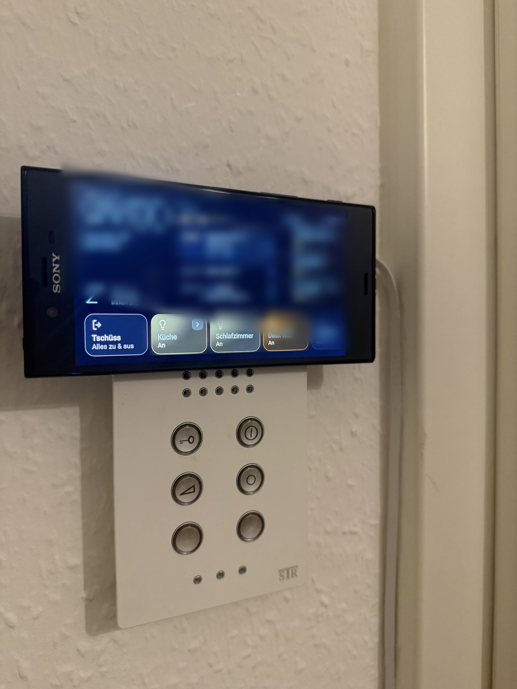
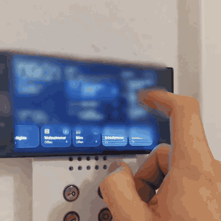
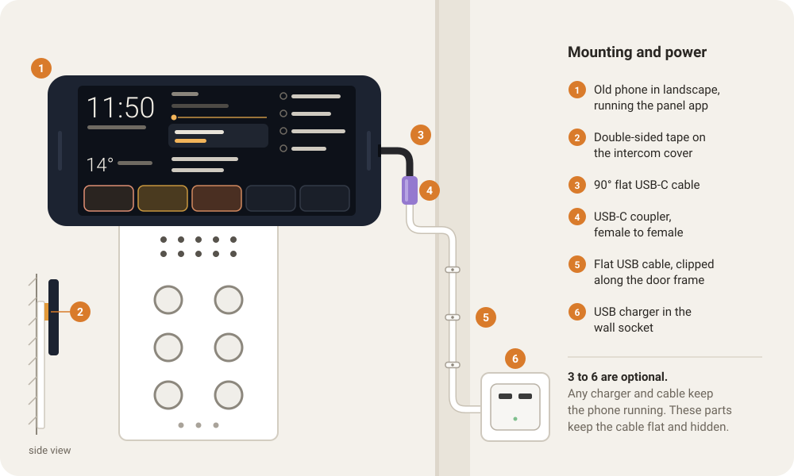

# An old phone as a wall display

This panel runs on a Sony Xperia XZ from 2016. An old phone suits the job well. It has a sharp touchscreen and Wi-Fi, it fits on a small piece of wall, and many people have one lying in a drawer.

## Where it sits

The phone hangs in landscape on the cover of the door intercom, right next to the front door. Double-sided tape holds it, and its lower edge overlaps the top of the intercom cover. You pass that spot every time you leave the house. That is the moment to check the day and to switch everything off with the goodbye tile.

[A short video](media/wall.mp4) shows it in use.

## Power

The phone runs on its charger all the time. Any charger and any cable do the job. I used flat parts to keep the cable flat against the wall and out of sight:

The numbers match the diagram.

3. A 90° flat USB-C cable leaves the side of the phone without sticking out.
4. A USB-C coupler, female to female, joins it to a longer flat cable.
5. Clips hold the long cable along the door frame.
6. A USB charger in the wall socket powers it all.

A phone that charges around the clock wears its battery out. Check it for swelling now and then, and take it off the wall if the back starts to bulge.

## Software

Sony's last official update for the Xperia XZ was Android 8. Mine runs an unofficial LineageOS 19.1 build, which is Android 12, but the panel app needs only Android 8. Keep **Android System WebView** up to date from the Play Store either way, because the panel runs inside it.

These phone settings help:

- Set the screen lock to **None**, so the panel is always one tap away.
- Make the panel app the default home app, so it comes back after a reboot.
- Lower the screen brightness. The panel has a dark background and stays readable when dim.

The app keeps the screen on, so the display never sleeps. Wi-Fi has to stay on for the panel to get updates.
